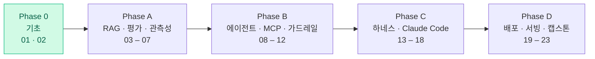

<div align="center">

# 🧪 dev-playground

**AI 기술을 공부하며 하루 하나씩 만들어가는 실습 공간**

LLM · RAG · 에이전트 · MCP · 평가 · 하네스 엔지니어링


</div>

<br/>

## 📌 이 레포는

튜토리얼 수준의 예제가 아니라, **실제 서비스에서 마주치는 문제를 작은 스케일로 직접 구현**하며 AI 기술을 공부하는 공간입니다.

- 🧩 프로젝트마다 실무 패턴 **하나**를 핵심으로 잡는다
- 📏 만들고 끝내지 않고 **평가셋 · 비용/지연 · 실패 사례**를 함께 기록한다
- 📝 기술 선택 근거를 직접 정리하며 학습한다

<br/>

## 🗂️ 완료한 프로젝트

| # | 프로젝트 | 핵심 스택 | 다루는 개념 |
|:-:|---------|-----------|------------|
| 01 | [🔍 Webhook Inspector](./01-webhook-inspector) | Node.js · WebSocket · SQLite · React | 실시간 이벤트 스트리밍, 웹소켓 팬아웃, 영속성 |
| 02 | [📄 RAG Doc Chat](./02-rag-doc-chat) | FastAPI · ChromaDB · LLM API · React | RAG 패턴, 임베딩, 벡터 검색, LLM 컨텍스트 주입 |

<br/>

## 🗺️ 로드맵

전체 계획과 의존 관계는 [CURRICULUM.md](./CURRICULUM.md)에 있습니다.



| Phase | 주제 | 프로젝트 | 상태 |
|:-----:|------|---------|:---:|
| 0 | 기초 | Webhook Inspector · RAG Doc Chat | ✅ |
| A | RAG · 평가 · 관측성 | RAG Eval Harness · Hybrid Search & Rerank · Prompt Manager + Tracing · Streaming Tool-use Chat · ReAct Agent | ⬜ |
| B | 에이전트 · MCP · 가드레일 | HITL Approval Agent · MCP Server · Orchestrator-Worker · Guardrails & Injection · LLM Gateway | ⬜ |
| C | 하네스 · Claude Code | Long-running Harness · Generator-Evaluator · Claude Code Toolkit · PR Review Bot · Commit Analyzer · Agent Memory | ⬜ |
| D | 배포 · 서빙 · 캡스톤 | Job Queue Dashboard · Doc Parsing → pgvector · Docker + CI Eval Gate · Local Serving & QLoRA · Capstone | ⬜ |

<br/>

## 🧭 공부 방식

```
만들기  ──►  측정하기  ──►  실패 분석  ──►  개선하기
 (구현)     (eval/, COST.md)  (FAILURES.md)   (ablation)
```

| 산출물 | 내용 |
|--------|------|
| `eval/` | 20~50문항 골든셋 또는 테스트 |
| `COST.md` | 요청당 토큰 · 비용 · p50/p95 지연 · 캐시 히트율 |
| `FAILURES.md` | 환각 · 검색 누락 · 도구 오호출 등 실패 사례 3개 이상 |

<br/>

## 📖 참고 자료

- Chip Huyen, *AI Engineering*
- 『하네스 엔지니어링 백과사전』
- 『클로드 코드 마스터』
- Anthropic Engineering Blog — *Building effective agents*, *Effective harnesses for long-running agents*
